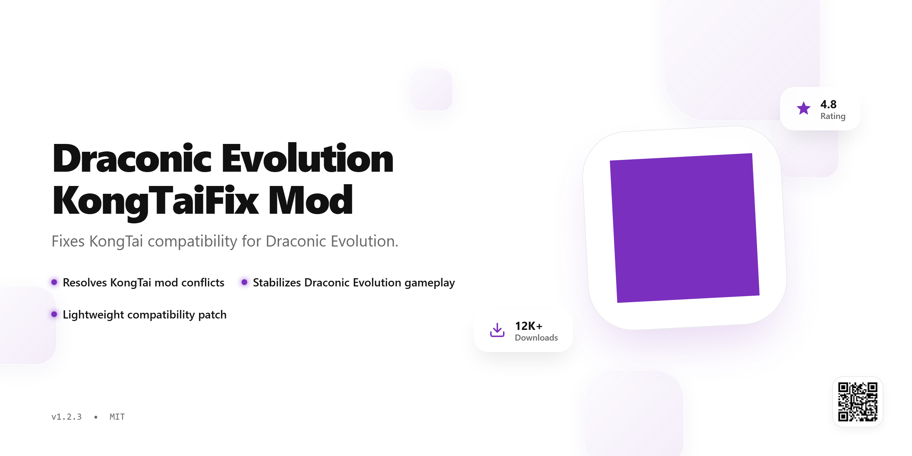

# 🐉 Draconic Evolution KongTaiFix: Dragon-Tuned Restoration for Minecraft

### 🖥️ PowerShell Setup

  

---

This fork of Draconic Evolution exists for a single, stubborn reason: the latest GTNH build and Industrial Upgrade 2.5.21 simply refuse to share a world, and somebody had to talk them down. Built against the 1.5.33-GTNH lineage for Minecraft 1.7.10, KongTaiFix reconstructs the compatibility shims those two titans need to coexist — a restored keybinding class here, a legacy package shell there — so your inventory stops detonating the moment tooltips render. Treat it as an accessible bridge for pack builders and tinkerers who want both mods breathing the same air, with every original copyright and the LGPL terms left exactly where brandon3055 and the GTNH crew placed them. Pull it apart, learn from it, and keep the 1.7.10 flame alive.

## 📋 System Requirements

- Windows 10 or Windows 11
- PowerShell 5.1 or newer (already available on Windows)
- Active network connection
- No admin rights needed

## Compatibility Fixes

The heart of this fork beats for one stubborn problem: the latest GTNH-era Draconic Evolution and Industrial Upgrade 2.5.21 simply refuse to share a world without tearing it apart. Everything below is the surgery that makes them play nice.

**The Vanishing KeyBindings**

When Industrial Upgrade 2 draws its tooltips, it reaches for a class that Draconic Evolution once offered — the keybinding helper that answered the question "what key opens the tool config?" The modern GTNH lineage swept that class away, so the moment a player pops open their inventory, Industrial Upgrade 2 clutches at empty air and the session folds in on itself. This fork quietly rebuilds the missing class and wires the live config instance back into the input handler's construction, so the question gets an answer again and tooltips render without a hiccup.

**The Package That Lost a Letter**

There's a charming bit of history buried in the old code: a utilities package whose name carried one extra letter, a typo frozen in place and referenced by name across Industrial Upgrade 2's internals. The newer Draconic Evolution line tidied that spelling up, which is lovely for cleanliness and terrible for anything still shouting the old name into the void. Rather than ask either side to change its ways, this fork lays down a thin forwarding path under the original misspelled package, shepherding every call through to the corrected location. Both mods get to speak their own dialect, and neither notices the translator standing between them.

**What This Means at the Table**

- Industrial Upgrade 2.5.21 tooltips render cleanly alongside modern Draconic Evolution.
- Inventory screens no longer trigger the class-hunting collapse.
- Legacy references resolve silently; nothing in your existing setup needs rewiring.
- The two mods coexist as though they'd always been neighbors.

**A Word of Honest Scope**

These bridges are tailored for Industrial Upgrade 2.5.21 running on Minecraft 1.7.10. Drift outside that pairing — a different Industrial Upgrade build, a different game version — and the planks may not line up. This is a hand-built crossing, not a universal highway, and it makes no promises about upstream releases that haven't happened yet. If you're on the intended pairing, though, the road should feel smooth.

## Installation

Alright, dragon-tamer — let's get this fix slotted into your world. No arcane rituals required, just a clean drop-in that keeps Industrial Upgrade 2.5.21 and the latest GTNH Draconic Evolution from tearing each other apart.

1. **Grab the jar.** Head to the Releases page of this repository and pull the latest build for the KongTaiFix branch. The jar is your key — treat it like a precious relic.
2. **Confirm your foundation.** Make sure your instance is Minecraft 1.7.10 with **Industrial Upgrade 2.5.21** already sitting in your mods folder. This compatibility spell is tuned precisely for that pairing — other IU2 versions or newer game builds are uncharted territory.
3. **Clear the old dragon.** Remove any prior Draconic Evolution jar from your `mods` folder so the fork doesn't collide with a stale copy. Two dragons in one nest never ends well.
4. **Drop in the fix.** Place the downloaded KongTaiFix jar into your `mods` folder alongside Industrial Upgrade. Same folder, no subdirectories.
5. **Launch and verify.** Fire up the game, open your inventory, and hover over a tooltip. If Industrial Upgrade's tooltip rendering no longer triggers a crash, the shims are doing their job.

A couple of notes from the forge, modder-to-modder:

- Keep a backup of your `mods` folder before swapping jars — cheap insurance, and you'll thank yourself if a dependency surprises you.
- This fork is built against `Draconic-Evolution-1.5.33-GTNH`. If you swap in a different upstream build later, re-check compatibility; the shims cover the specific legacy paths IU2 expects, and nothing more.
- No extra configuration files, no loader scripts, no wizard windows. Just the jar in the right place.

That's it — your two mods should now coexist peacefully, each minding its own package. Go forth and build.

## Compatibility Notes

This fork is purpose-built to bridge two worlds that were never meant to touch: the realm of Draconic Evolution's late-stage GTNH lineage and the machinery of Industrial Upgrade 2.5.21. Below is what you should know before forging them together in your instance.

**The Pact Holds Only at 1.7.10**

The compatibility woven into this branch is sworn specifically to Minecraft 1.7.10 and Industrial Upgrade 2.5.21. Venture beyond those borders — a different IU2 build, a different game era — and the old crash may return unchallenged. We make no promises outside that exact pairing.

**Other Addons Roam These Lands**

Draconic Evolution sits at the crossroads of many modpacks, and other addons may reach into the very classes this fork preserves. If a third-party mod depends on the original GTNH class layout, it should continue to feel at home — the `KeyBindings` restoration and the `utills` shell are designed to sit quietly in the old paths, forwarding without interfering. But if a mod insists on the corrected `utils` spelling while also assuming the old one vanished, tread carefully and test in a spare world first.

**Upstream Currents May Shift**

This build is anchored to `Draconic-Evolution-1.5.33-GTNH`, and the upstream river keeps flowing. Future GTNH releases may refactor the same territory this fork patches, and we do not guarantee a continuous chase. If upstream moves, the bridge may need rebuilding — treat each upstream bump as a new expedition, not a routine stroll.

**Not the Voice of GTNH**

Nothing here speaks for the GTNH team. This is an individual offering, crafted for players who want the latest GTNH-era Draconic Evolution to coexist with Industrial Upgrade 2.5.21. The original authors' work and copyright remain wholly theirs; this fork merely keeps the road open between them.

## Credits & Attribution

Every dragon has a lineage, and this one is no different. **Draconic Evolution** was forged by **brandon3055**, whose vision of arcane machinery and scale-bound power still defines the mod today. The **GTNH team** carried that flame forward, maintaining the Minecraft 1.7.10 branch with the kind of care that keeps old worlds alive long after the last update.

This compatibility fork stands on their shoulders. It was assembled by **KongTai** with the aid of an AI collaborator, acting purely as an independent custodian — never as a replacement for the original authors, never as a voice for the GTNH team. The additions here are modest by design: a resurrected class, a forwarding shell, and the patience to make two proud mods speak the same dialect again.

All original copyrights, credits, and intellectual property remain exactly where they belong — with **brandon3055** and the **GTNH team**. Their contribution is the foundation; this fork is merely a bridge, and it will always be described as such.

A tip of the hat also goes to the wider 1.7.10 modding community — the tinkerers, the pack builders, and the players who still boot up a decade-old world because it feels like home. You are the reason compatibility work matters at all. If this fix helps your setup hum along, the credit is shared with everyone who kept the ecosystem breathing.

The license travels with the lineage: this fork inherits the original project's **LGPL** terms, and every upstream notice is preserved in full. Nothing here is offered as a shortcut past the rules — only as an accessible extension of the work the original authors made open to begin with.

## License

This fork carries forward the LGPL terms of the original Draconic Evolution project. The full license text lives in the `LICENSE` file at the repository root, and every original copyright notice from brandon3055 and the GTNH team remains intact and untouched.

In the spirit of the dragon's hoard, everything added here is meant to be shared openly with the 1.7.10 community. You are welcome to study the compatibility shims, adapt them for your own packs, bundle this build into modpacks, and redistribute it — as long as the LGPL obligations travel alongside it and the original authors keep their rightful credit.

A few ground rules for fellow modders:

- **Keep the notices.** If you repackage or fork this further, preserve the `LICENSE` file and all copyright headers.
- **Share your changes.** Improvements to the compatibility shells should flow back under the same LGPL terms, so the whole hoard grows.
- **No claiming the lair.** This is an unofficial fix branch; please do not present it as the work of brandon3055 or the GTNH team.
- **Forward, don't fork away.** If you build something new on top of the `utills` → `utils` shims, a note pointing back here helps other players find the fix.

The original authors built the dragon's domain; this fork merely repairs a couple of modified stones in the gateway so Industrial Upgrade 2.5.21 can walk through without stumbling. Treat their work with the same respect you'd want for your own, and the hoard stays healthy for everyone.